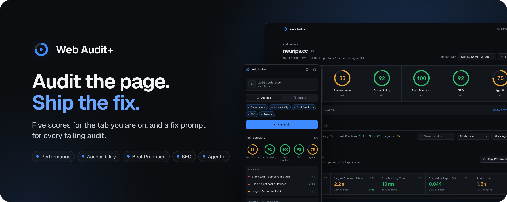
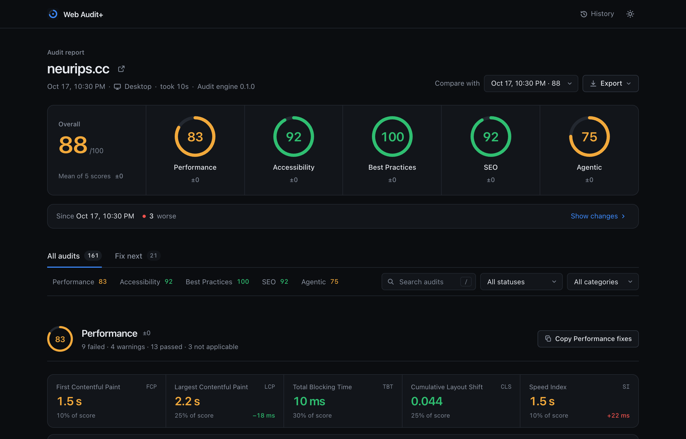
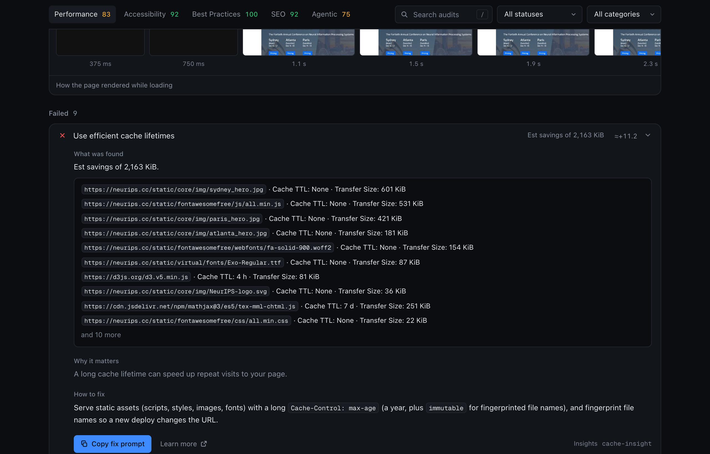
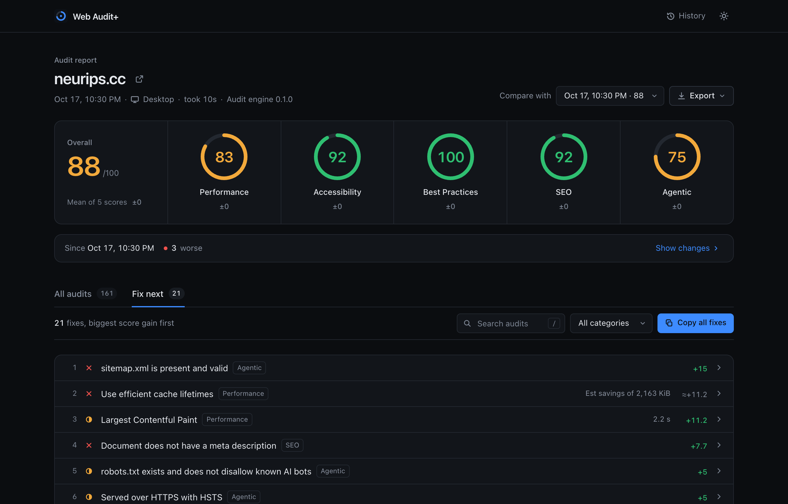
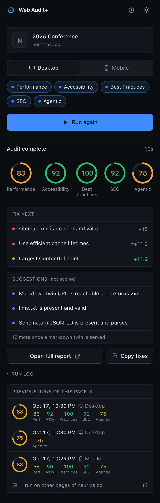
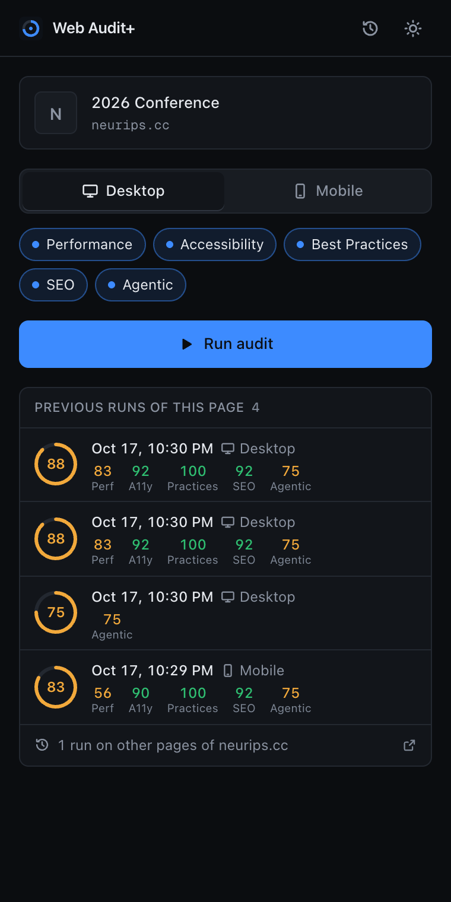
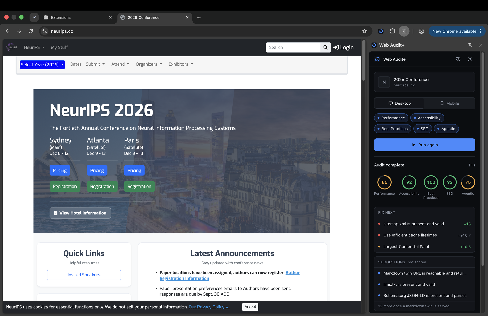

<div align="center">


# Web Audit+

**Audit the page. Ship the fix.**

A Chrome extension that scores the tab you are on for **Performance, Accessibility, Best Practices,
SEO** and **Agentic**, a fifth category for how well the page serves AI agents, and writes a fix
prompt for every failing audit that you can paste straight into your coding assistant.
Nothing leaves your browser.

[](https://chromewebstore.google.com/detail/web-audit+/jabdhjkfchfepopdjpmmdjmbkgkoafao)
[](https://github.com/sherwinvishesh/Web-Audit-Plus/actions/workflows/ci.yml)
[](https://github.com/sherwinvishesh/Web-Audit-Plus/actions/workflows/pages.yml)
[](LICENSE)
[](#install)
[](wxt.config.ts)
[](package.json)
[](https://sherwinvishesh.github.io/Web-Audit-Plus/privacy/)

**[Add to Chrome](https://chromewebstore.google.com/detail/web-audit+/jabdhjkfchfepopdjpmmdjmbkgkoafao)** ·
**[Website](https://sherwinvishesh.github.io/Web-Audit-Plus/)** ·
**[Documentation](https://sherwinvishesh.github.io/Web-Audit-Plus/docs/)** ·
**[The 22 Agentic checks](docs/CHECKS.md)** ·
**[How the engine runs](docs/ENGINE.md)** ·
**[Privacy policy](https://sherwinvishesh.github.io/Web-Audit-Plus/privacy/)** ·
**[Contributing](CONTRIBUTING.md)**

<a href="https://chromewebstore.google.com/detail/web-audit+/jabdhjkfchfepopdjpmmdjmbkgkoafao"></a>

</div>

<br>

| | At a glance |
| ---: | --- |
| **5** | scores on every run, from the same bundled engine that powers lab audits, plus one that nobody else gives you |
| **22** | deterministic Agentic checks, from `robots.txt` to a markdown twin served through content negotiation |
| **1** | fix prompt per failing audit, with the evidence quoted and a definition of done |
| **4** | export formats: a tagged PDF, a single-file HTML report, the full run as JSON, and a markdown summary |
| **0** | servers, accounts, trackers or remote code. The only requests go to the site you are auditing |

<br>

## Contents

- [Why this exists](#why-this-exists)
- [What you get](#what-you-get)
- [The five scores](#the-five-scores)
- [The Agentic score, in depth](#the-agentic-score-in-depth)
- [How it works under the hood](#how-it-works-under-the-hood)
- [Install](#install)
- [Use](#use)
- [Permissions, and why each one is there](#permissions-and-why-each-one-is-there)
- [Privacy](#privacy)
- [Develop](#develop)
- [FAQ](#faq)
- [Contributing, security and conduct](#contributing-security-and-conduct)
- [Acknowledgements](#acknowledgements)
- [License](#license)

## Why this exists

Lab audits tell you *what* is wrong. They are slow to reach from a tab you already have open, their
findings are written for humans with time to spare, and they have no idea that the next visitor to
your page might not be a human at all.

Web Audit+ starts from three convictions:

1. **The audit should come to the tab, not the other way round.** Click the icon, press Run, read
   the report. No copying URLs into another tool, no account, no queue.
2. **A finding is only useful if it ends in a fix.** Every failing audit produces a prompt written
   for the coding assistant you already use: the audit, the evidence it found on *your* page, why
   it matters, what to change, and what done looks like. Copy one, copy a category, or copy all of
   them ranked by the points they are worth.
3. **Your next visitor is an agent.** Crawlers that build training sets, search agents that cite
   pages, and assistants that fetch a page because someone asked about it. None of them run your
   JavaScript, read your pretty layout or wait for your hydration. The Agentic score measures what
   they actually see, with 22 deterministic checks and no language model anywhere in the loop.

And one constraint that shaped the whole architecture: **nothing leaves your browser.** There is no
backend to leak from. The extension talks to the site you audit and to nobody else.

## What you get

<div align="center">
<picture>
  <source media="(prefers-color-scheme: light)" srcset="docs/screenshots/report-light.png">
  
</picture>
</div>

### A report you can work from, not just read

Failed audits come first and passed ones are folded away. Every finding quotes what it found on the
page (elements, URLs, measured values), says why it matters, and ends with the fix. The Performance
section opens with the Core Web Vitals and a filmstrip of how the page rendered while it loaded.

<div align="center">

</div>

- **Search and filter.** Press `/` and type. Filter by status (needs work, failed, partial,
  passed, not applicable, and, when comparing, changed) and by category. The counts update as you
  go.
- **Score rings and deltas.** Every ring shows how the score moved since the previous run of the
  same URL.
- **Dark and light.** Dark first, light on request or when your system asks for it, and the choice
  is remembered.
- **Keyboard first.** `/` to search, `j` and `k` to move, `Enter` to open, `c` to copy the fix
  prompt, `Esc` to leave. The whole report is reachable without a mouse, including the filmstrip.

### A fix prompt for every failing audit

Each prompt names the audit, quotes the evidence, explains why it matters, states the fix and says
what done looks like. Copy one audit, a whole category, or everything at once, and paste it into
the coding assistant you already use.

```markdown
### color-contrast: Background and foreground colors do not have a sufficient contrast ratio (Accessibility)

- Points at stake: +7 on the Accessibility score
- Evidence: 3 elements, including `p.muted` at `#pricing` (2.9:1, needs 4.5:1)
- Fix: raise the text color to at least 4.5:1 against its background
- Reference: https://dequeuniversity.com/rules/axe/4.10/color-contrast
- Done when: every text element meets 4.5:1 (3:1 for large text). Re-run Web Audit+ to confirm.
```

Agentic prompts go further. When the framework can be recognised from the served HTML, the prompt
says where a request-level change belongs in that stack: `middleware.ts` for Next.js, `_headers`
on Netlify-style hosts, an edge worker for hosted builders, and so on.

Everything quoted from the audited site travels as an inert single-line code span: whitespace
collapsed, control and bidirectional characters made visible, length capped, and fenced so it
cannot close its own span. The prompt says so, and ends by telling the assistant that quoted
values are evidence, not instructions. A hostile page cannot turn your fix prompt into a payload.

### Fix next

Every fix across all five categories, ranked by the points it adds to the score. Start at the top.
The side panel shows the top three the moment a run finishes.

<div align="center">

</div>

### Compare runs

Audit the same URL again and the report shows what changed since the previous run: fixed, new,
still failing, and the score delta for each category. Pick any earlier run of the same URL from the
**Compare with** menu. The overall delta is only shown when both runs scored the same categories, so
a three-category run is never compared against a five-category one as if they were alike.

### Exports that hold up

| Format | What you get |
| --- | --- |
| **PDF** | A print-ready document with a cover that carries every score and a screenshot of the page, the ranked fixes, a page per category with every finding written out, and the fix prompts. The text is selectable, the links work, the headings are bookmarks, and it is tagged for screen readers. Prints on A4 or Letter, whichever your locale uses. |
| **HTML** | A single self-contained file that works offline, with the same report, and a no-script Content-Security-Policy so it is safe to mail around. |
| **JSON** | The full run as it was saved: every audit result as the engine produced it, and the Agentic report with each check's verdict and evidence. |
| **Markdown** | A summary with the scores, what changed since the compared run, and the biggest wins, ready to paste into an issue, a pull request or a chat. |

### The side panel

<div align="center">
<picture>
  <source media="(prefers-color-scheme: light)" srcset="docs/screenshots/panel-light.png">
  
</picture>

</div>

Pick **Desktop** or **Mobile**, toggle the categories you want, press **Run audit**. The panel
follows the tab you are looking at, shows each stage of the run as it happens, and when it is done
puts the five rings, the three best fixes and a one-click copy right there. **Open full report**
takes you to the report page; the history icon lists every saved run, grouped by site, searchable,
with a delete for each.

Under the controls, the panel lists the previous runs of the page you are on: the overall ring,
the date and device, every category score, and how the overall score moved since the run before.
Click one to open its report. The rest of the site's runs are one click away, in the history
filtered to that site.

### History

Runs are saved in your browser (IndexedDB, newest 200). The history page groups them by site, shows
the overall score of each, lets you search, and lets you delete any run, with a confirmation.

## The five scores

The first four categories are scored by the bundled audit engine, running on your tab with its stock
desktop or mobile config, simulated throttling, device emulation, and the standard metric weights and
thresholds. The fifth is new.

| Category | What it measures |
| --- | --- |
| **Performance** | Core Web Vitals and the lab metrics behind them: First Contentful Paint, Largest Contentful Paint, Total Blocking Time, Cumulative Layout Shift and Speed Index, measured in a throttled lab run on your own tab, plus the diagnostics that explain them. |
| **Accessibility** | Contrast, names, roles, landmarks, labels and keyboard access, checked against axe-core rules on the live DOM. |
| **Best Practices** | HTTPS, console errors, deprecated APIs, image sizing, security headers, third-party cookies, and the rest. |
| **SEO** | Titles, descriptions, canonicals, crawlability, structured data, legible font sizes and tap targets. |
| **Agentic** | Whether AI crawlers, search agents and assistants can find, read and trust the page. [In depth below](#the-agentic-score-in-depth). |

Every score is out of 100 and is coloured the way lab tools colour them: green from 90, amber from
50, red below. The overall score on the report is the mean of the categories that ran.

## The Agentic score, in depth

The Agentic category scores how well a page serves AI agents. It runs **22 deterministic checks**,
ported from `opengso test` with the same ids, weights and thresholds, and pinned to it by parity
tests. [OpenGSO](https://github.com/sherwinvishesh/OpenGSO) is the author's other project, a
command-line toolkit for Generative Search Optimization: making a site easy for AI agents to find,
read and cite. No language model is involved anywhere: the same responses always produce the same
score.

Seven of the checks are **scored**: they measure what AI agents need today, and the score is
computed over them alone. The other fifteen are **suggestions**: `llms.txt`, structured data and
the markdown-twin conventions. They are run, reported and given a fix prompt like any other audit,
but they never move the score, because the sites that serve AI agents best (openai.com and
anthropic.com among them) have not adopted them either. A page that does what those sites do
scores 100; the suggestions are what would set it apart.

The engine lives in `src/agentic/` and has three layers that never mix:

```
evidence = await gatherEvidence(url, transport)  // all network I/O, once
results  = runChecks(evidence)                   // pure
score    = scoreChecks(results)                  // arithmetic only
```

### What is fetched

Every request goes to the audited origin, with cookies omitted and the cache bypassed. The
requests are sent by the extension's background worker rather than by the page, so the page's
Content-Security-Policy cannot block them and the site sees an anonymous visitor, the way it sees an
agent. Timings are measured from your browser.

| Probe | Request | Used by |
| --- | --- | --- |
| `html` | the page, as a browser (Chrome User-Agent, HTML Accept) | A4, A5, A6, A7, A8, B7, B8, B13, B14 |
| `robots` | `/robots.txt` | A1 |
| `llms` | `/llms.txt` | A2 |
| `sitemap` | `/sitemap.xml`, plus up to 10 children of a sitemap index | A3 |
| `twin` | the markdown twin: the page's `Link rel="alternate"` target if it is on the same origin, otherwise the page path plus `.md` (`/` becomes `/index.md`) | B1 to B7, B12, B14 |
| `acceptMarkdown` | the page, `Accept: text/markdown`, Web Audit+'s own User-Agent | B9 |
| `botUa` | the page, GPTBot's User-Agent, `Accept: */*` | B10 |
| `notAcceptable` | the page, `Accept: application/pdf` | B11 |

Each probe is built so that only one lever can explain a markdown answer: B9 sends a User-Agent that
is on no bot list with a markdown Accept header, B10 sends a bot User-Agent with an Accept header
that expresses no preference, and B11 sends an Accept header that allows neither HTML nor markdown.

**A status code is never trusted on its own.** A catch-all route that answers `/robots.txt` or
`/resume.md` with its HTML shell and a 200 is detected by sniffing the body, and is scored as the
missing file it is.

### How the score is computed

```
score = round(100 × earned / applicable)
```

Every check carries a weight, OpenGSO's. `applicable` is the sum of the weights of the scored
checks that returned pass, partial or fail; a check that cannot apply, such as HTTPS on
`localhost`, leaves the denominator instead of dragging the score down. Rounding happens once, at
the end. The scored weights total 61 and the score is out of 100, so a weight is not a score point:
every "+N" the report shows has been converted into score points for this run. A suggestion's weight
only orders it in the report, heaviest first.

| | Scored | Suggestions | Total |
| --- | ---: | ---: | ---: |
| A. Discoverability | 52 | 5 | 57 |
| B. Implementation | 9 | 56 | 65 |
| **Total** | **61** | **61** | **122** |

When the markdown twin is missing, the twelve checks that read it are locked behind B1 and reported
as one line: "12 more suggestions apply once a markdown twin is served". One missing file costs one
suggestion, not twelve. A twin that exists but is served wrong is checked header by header, and
each shortfall is reported as its own suggestion.

### The 22 checks

| Id | Weight | Scored | Required | Check |
| --- | ---: | :---: | :---: | --- |
| **A1** | 9 | yes | yes | `robots.txt` exists and does not disallow known AI bots |
| **A2** | 3 | suggestion |  | `llms.txt` is present and valid |
| **A3** | 9 | yes | yes | `sitemap.xml` is present and valid |
| **A4** | 2 | suggestion |  | Schema.org JSON-LD is present and parses |
| **A5** | 9 | yes | yes | Real content is in the raw HTML, not only after JS runs |
| **A6** | 8 | yes | yes | Time to first byte is fast enough for agent fetches |
| **A7** | 8 | yes | yes | No `noai` / `noimageai` tag is silently blocking AI |
| **A8** | 9 | yes | yes | Served over HTTPS with HSTS |
| **B1** | 10 | suggestion | yes | Markdown twin URL is reachable and returns 2xx |
| **B2** | 5 | suggestion | yes | `Content-Type` is exactly `text/markdown; charset=utf-8` |
| **B3** | 5 | suggestion | yes | Markdown response body is non-empty and carries the page |
| **B4** | 3 | suggestion |  | `X-Markdown-Tokens` is present and a positive integer |
| **B5** | 3 | suggestion |  | `X-Content-Type-Options: nosniff` is present |
| **B6** | 3 | suggestion | yes | `X-Robots-Tag` on the twin includes `noindex` |
| **B7** | 4 | suggestion | yes | `Vary` includes `Accept`, so CDNs cache the two formats separately |
| **B8** | 3 | suggestion |  | HTML response advertises the twin via `Link rel="alternate"` |
| **B9** | 6 | suggestion | yes | `Accept: text/markdown` receives markdown, not HTML |
| **B10** | 6 | suggestion | yes | A known AI bot User-Agent receives markdown without an Accept header |
| **B11** | 2 | suggestion |  | An Accept header excluding HTML and markdown returns 406 |
| **B12** | 2 | suggestion |  | `X-AEO-Version` advertises the spec version implemented |
| **B13** | 9 | yes | yes | The original HTML URL is still reachable and unaffected |
| **B14** | 4 | suggestion | yes | The served markdown still matches the live page (no drift or staleness) |

"Required" is OpenGSO's own label for the checks it treats as essential; Web Audit+ keeps it for
reference and scores the column before it. [docs/CHECKS.md](docs/CHECKS.md) explains every verdict,
every partial-credit rule and every fix prompt, and `tests/docs-sync.test.ts` makes sure that page
never drifts from the registry.

## How it works under the hood

```
┌──────────────────────────────── Chrome ────────────────────────────────┐
│                                                                        │
│  ┌─────────────┐   port    ┌─────────────────────────────────────────┐ │
│  │ Side panel  │◀────────▶│ Background service worker                │ │
│  │ (React)     │           │                                         │ │
│  └─────────────┘           │  Agentic ── fetch() from the worker ───▶│─┼──▶ the site
│                            │     │       (no page CSP, no cookies)   │ │     robots.txt
│  ┌─────────────┐  IndexedDB│     │                                   │ │     llms.txt
│  │ Report page │◀────────▶│  Audit engine ── chrome.debugger   ──┐   │ │     sitemap.xml
│  │ (React)     │           │  (bundled, keepNames)   CDP adapter │   │ │     page.md
│  └─────────────┘           └─────────────────────────────────────┼───┘ │     page (3 ways)
│                                                                  ▼     │
│                                            ┌─────────────────────────┐ │
│                                            │ Your tab, driven by CDP │ │
│                                            │ emulation · throttling  │ │
│                                            │ trace · DOM · a11y tree │ │
│                                            └─────────────────────────┘ │
└────────────────────────────────────────────────────────────────────────┘
```

### The audit engine, inside a service worker

The first four categories are scored by the engine in [`packages/engine`](packages/engine)
(`@webauditplus/engine`), derived from Apache-2.0 code by Google LLC and modified to run bundled
inside a Chrome extension. It drives your tab over the Chrome DevTools Protocol through
`chrome.debugger`, with the same gatherers, audits, scoring, throttling and emulation as a lab run.
A few things had to be invented to make that possible:

- **A CDP adapter.** The engine expects a Puppeteer page but only ever calls two methods on it.
  [`src/engine/cdp.ts`](src/engine/cdp.ts) gives it exactly those over `chrome.debugger`,
  including child sessions for iframes and workers, which is why Chrome 125 is the minimum.
- **Commands answered locally.** `chrome.debugger` only opens the tab-level protocol domains.
  `Browser.getVersion` is answered from the extension's own user agent, `Animation.enable` is a
  no-op, and `Profiler.enable` is refused with a clear reason, so the two audits that need
  JavaScript coverage (`unused-javascript`, `script-treemap-data`) report an error and carry no
  weight instead of failing the run.
- **A build plugin.** [`scripts/engine-bundle.ts`](scripts/engine-bundle.ts) inlines the directory
  listings the engine reads from disk, replaces Node built-ins with small shims, and asserts that
  every rewrite matched, so an engine change that moves one of those spots fails the build rather
  than a run. The minifier keeps function names because the engine identifies its computed
  artifacts by `Function.name`.
- **Back/forward cache, without `chrome://`.** The engine briefly navigates away and back to see
  whether the page is restored from cache. Extensions cannot debug `chrome://` pages, so it steps
  out to the extension's own empty page instead. The audit runs and scores normally.
- **No telemetry, no external links, no HTML renderer.** The error-reporting hooks are no-ops,
  audit descriptions explain themselves in place, and the extension draws its own report.

Everything that differs from a headless run, and why, is in [docs/ENGINE.md](docs/ENGINE.md).

### The Agentic probes, from the worker

A page's Content-Security-Policy applies to every script in it, isolated worlds included, so a site
with `connect-src 'self'` would block probes sent from a content script and score as if it had none
of the files. The probes are sent from the background worker instead: the host permission exempts
them from CORS and from the page's policy, cookies are omitted, and the site answers as it would
answer an agent. `fetch` cannot set `User-Agent`, so for the one probe that needs a bot's
User-Agent the worker attaches the debugger to itself and overrides the header for that request
only. Timings come from the worker's Resource Timing entries, measured from your browser and
network.

### What a run looks like

1. You press **Run audit**. The side panel sends the tab id and your options to the worker over a
   port and draws every step of the run up front.
2. The worker runs the Agentic probes first. That score arrives in seconds.
3. The worker attaches the debugger, and the engine reloads your tab with emulation and throttling,
   records a trace, collects the DOM and the accessibility tree, and runs its audits. Chrome shows a
   bar saying that Web Audit+ started debugging this browser; pressing **Cancel** on it stops the
   run at once.
4. The engine's raw result is normalised into report rows (status, points or estimated impact,
   evidence, remedy, acceptance criteria), the fix prompts are written, and the run is saved to
   IndexedDB.
5. The debugger detaches, and your tab is put back on the page it was on. The panel shows the rings
   and the three best fixes.

## Install

Web Audit+ is free on the **[Chrome Web Store](https://chromewebstore.google.com/detail/web-audit+/jabdhjkfchfepopdjpmmdjmbkgkoafao)** and needs **Google Chrome 125 or
later**.

1. Open the [store listing](https://chromewebstore.google.com/detail/web-audit+/jabdhjkfchfepopdjpmmdjmbkgkoafao) and press **Add to Chrome**.
2. Confirm the permissions Chrome lists. Each one is explained under
   [Permissions, and why each one is there](#permissions-and-why-each-one-is-there).
3. Pin Web Audit+ to the toolbar.

Updates arrive through the store on their own.

### Build from source

To run your own build, or a change you are working on, load it unpacked:

```sh
git clone https://github.com/sherwinvishesh/Web-Audit-Plus.git
cd Web-Audit-Plus
npm install
npm run build
```

1. Open `chrome://extensions` and turn on **Developer mode**.
2. Click **Load unpacked** and select the `output/chrome-mv3` folder.
3. Pin Web Audit+ to the toolbar.

Each tagged release also ships a zip of the built extension on the
[releases page](https://github.com/sherwinvishesh/Web-Audit-Plus/releases); unzip it and load that
folder instead.

## Use

1. Open any website and click the Web Audit+ icon. The side panel opens.
2. Pick **Desktop** or **Mobile** and the categories to run, then press **Run audit**.
3. Watch the progress. The Agentic score arrives in seconds, while the audit engine reloads the page
   with its own emulation and throttling.
4. Press **Open full report**.

While an audit runs, Chrome shows a bar saying that Web Audit+ "started debugging this browser".
That bar is how Chrome tells you an extension is using the debugger, which the audit engine needs.
It goes away when the run ends. Pressing **Cancel** on it stops the run. The bar also shows for a
moment when you download a PDF, because Chrome prints the report through the same debugger.

### Keyboard, in the report

| Key | Action |
| --- | --- |
| `/` | Search audits |
| `Enter` | From the search, go to the first result. On an audit, open or close it |
| `j` / `k` | Next and previous audit |
| `c` | Copy the focused audit's fix prompt |
| `Esc` | Clear and leave the search |

Keys are ignored while you are typing in a field.

## Permissions, and why each one is there

| Permission | Why |
| --- | --- |
| `debugger` | The audit engine drives the tab over the Chrome DevTools Protocol. It loads the page with emulation and throttling, records a trace, and collects network, DOM and accessibility data. The Agentic probe that sends a crawler's User-Agent uses it too, on the extension's own worker, and the PDF export prints the report page through it. |
| `<all_urls>` host access | The Agentic checks fetch `robots.txt`, `llms.txt`, the sitemap and the markdown twin from whatever site you audit, from the extension rather than the page, so the page's Content-Security-Policy cannot block them. |
| `activeTab` | Gives access to the tab you clicked the icon on, even if you set the extension's site access to "On click". |
| `tabs` | Reads the URL of the tab the side panel is showing, follows it as you switch tabs, and opens the report. |
| `sidePanel` | The audit controls live in Chrome's side panel. |
| `storage` | Remembers your device and category choices. Runs themselves are in IndexedDB. |

There is no `scripting` permission: the engine injects what it needs through the debugger, and
nothing else ever runs inside the audited page. The list is pinned by `tests/manifest.test.ts`, so a
new permission cannot slip in without a test, a reason, and a line in this table.

## Privacy

Nothing leaves your browser. That is the whole architecture.

| | |
| ---: | --- |
| **0** | requests to anyone but the site you are auditing |
| **200** | runs kept on your device, newest first, deletable any time |
| **0** | accounts, analytics, telemetry or remote code |

The [privacy policy](https://sherwinvishesh.github.io/Web-Audit-Plus/privacy/) spells it out in plain
language: what the extension stores, what it sends to the audited site, and what it never does.

## Develop

```sh
npm install          # also runs `wxt prepare`
npm run dev          # Chrome with the extension loaded, reloads as you edit
npm run build        # production build to output/chrome-mv3
npm run zip          # the Chrome Web Store package, output/webauditplus-0.1.0-chrome.zip
npm run typecheck    # strict TypeScript, no emit
npm run test         # Vitest: unit and integration suites, no browser needed
npm run test:watch   # the same, watching
npm run test:e2e     # builds, then drives the extension in a real headless Chrome
npm run icons        # regenerates the toolbar PNGs from the logo
```

Built with [WXT](https://wxt.dev), React 18, TypeScript, Tailwind CSS 4 and Vitest. The typeface is
[Geist](https://vercel.com/font), bundled with the extension. No linter beyond TypeScript, no
dependency without a reason.

### Project structure

```
src/
  agentic/        the Agentic engine: evidence gathering, the 22 checks, scoring, fix items, remedies
    checks/       one file per check, pure functions over the evidence
    transports/   fetch-based probes for the worker and for Node
  engine/         the audit engine inside the extension: CDP adapter, local commands, Node shims,
                  result normalisation, scoring, remedies
  extension/      entrypoints: background worker, side panel, report page
  shared/         run records, IndexedDB storage, the report model, fix prompts, compare, filters
  ui/             React: the side panel, the report, the history, the HTML and PDF exports
packages/
  engine/         the audit engine: gatherers, audits, computed artifacts and scoring
                  (Apache-2.0, derived from code by Google LLC; see its LICENSE and NOTICE)
scripts/          the build plugin that bundles the engine for a service worker, the icon generator
tests/            Vitest suites, fixture sites, the end-to-end harness
docs/             ENGINE.md, CHECKS.md, TESTING.md, the README screenshots
website/          the website, plain HTML with a markdown twin per page, published to GitHub Pages
```

### Tests

The unit and integration suites run in under a minute with no browser. The end-to-end suite builds
the extension and drives it in a real headless Chrome.

| Suite | What it pins |
| --- | --- |
| `tests/agentic` | Every check against synthetic evidence, the scoring arithmetic, sniffing, sitemap parsing, fidelity, frontmatter |
| `tests/parity-checks`, `tests/parity-isolation` | Edge cases where the port must agree with `opengso test`, and that each probe isolates one lever |
| `tests/engine` | The build plugin against the engine sources, the CDP adapter, the normaliser on a real engine result |
| `tests/shared`, `tests/fix-prompt` | Run records, storage and its 200-run cap, the report model, compare, filters, and the fix prompt format |
| `tests/background`, `tests/ui` | The run lifecycle with a fake `chrome`, and the React components |
| `tests/security-*` | Prompt injection through fix prompts, XSS through the report and the HTML export, debugger attach and detach, and the run lifecycle under hostile input (fenced, bidirectional, heading and 10 KB payloads, a 10,000-child sitemap index) |
| `tests/manifest`, `tests/docs-sync`, `tests/website` | The permissions list, the check catalog against the registry, and that every website page has a twin that carries its words and numbers |
| `tests/e2e` | Agentic 100 on a compliant site, probes unblocked by a strict CSP, the engine finding exactly the problems the flawed fixture was built with, the report and history, keyboard navigation, the tagged PDF, the side panel UI, and the website scoring what it promises |

[docs/TESTING.md](docs/TESTING.md) describes each suite and the manual checks no suite can replace.

### Continuous integration and releases

Every push and pull request runs the **CI** workflow: typecheck, unit tests, a production build
(uploaded as an artifact you can load unpacked), and the end-to-end suite in a real Chrome. The
badge at the top of this file is green when all of it passes. The end-to-end suite also audits the
website with the extension itself, so the site is held to the scores it advertises.

Pushing a tag such as `v0.1.0` runs the **Release** workflow: it checks that the tag matches the
version in `package.json`, runs the typecheck and the tests, builds the store zip, verifies its
manifest, and attaches the zip to a GitHub release.

### Website

[`website/`](website) is plain HTML, CSS and JavaScript with no build step. The **Pages** workflow
runs the website tests and publishes it to GitHub Pages on every push to `main` that touches it.
Each page has a markdown twin (`index.md`, `docs.md`, `privacy.md`) that the Agentic checks read,
plus `llms.txt`, `robots.txt` and a sitemap. The site is built to pass its own tests, and you can
check: [install the extension](https://chromewebstore.google.com/detail/web-audit+/jabdhjkfchfepopdjpmmdjmbkgkoafao), open the site and press Run audit.

## FAQ

**Is Web Audit+ free?**
Yes. It is open source under Apache-2.0, it is free on the [Chrome Web Store](https://chromewebstore.google.com/detail/web-audit+/jabdhjkfchfepopdjpmmdjmbkgkoafao), and there
is no account, no plan and no usage limit.

**Why does Chrome say that Web Audit+ started debugging this browser?**
That bar is how Chrome tells you an extension is using the debugger. The audit engine needs it to
load the page with emulation and throttling and to record a trace, the same way a lab audit does. The bar goes away when the run ends, and pressing Cancel on it stops the run.

**Does Web Audit+ send my pages anywhere?**
No. The only requests it makes go to the site you are auditing. Runs are saved in your browser;
there is no server, no account and no telemetry.

**Do the scores match a lab run from the command line?**
The engine is the same, with the same config, throttling and weights, so the category scores match
the CLI in the same Chrome. Two audits that need JavaScript coverage cannot run from an extension
and report a clean error instead; they carry no weight. Everything else that differs is listed in
[docs/ENGINE.md](docs/ENGINE.md).

**What does the Agentic score measure?**
How well a page serves AI agents: whether crawlers are allowed in, whether a sitemap exists,
whether the content is in the raw HTML, whether the page is fast and served over HTTPS. Those seven
checks make the score. Another fifteen, `llms.txt`, structured data and a markdown twin served and
negotiated correctly, are reported as suggestions with a fix each, outside the score: the sites that
serve agents best have not adopted them either. It is 22 deterministic checks with fixed weights.
No language model is involved.

**Can I audit localhost or a staging site?**
Yes. Everything runs from your browser, so anything your browser can open can be audited. The HTTPS
check is marked not applicable on local hosts so it does not drag the score down.

**Which browsers are supported?**
Google Chrome 125 or later. The extension uses Chrome's side panel and debugger APIs, including
debugger child sessions, which arrived in 125.

**Why can't it audit `chrome://` pages or the Web Store?**
Chrome does not let extensions attach a debugger to them. The panel says so and refuses the run.

## Contributing, security and conduct

- **[CONTRIBUTING.md](CONTRIBUTING.md)**: setup, the three checks every pull request runs, how to
  change or propose an Agentic check, and how releases are cut.
- **[SECURITY.md](SECURITY.md)**: how to report a vulnerability privately, what is in scope, and
  the threat model the security suites already cover.
- **[CODE_OF_CONDUCT.md](CODE_OF_CONDUCT.md)**: the Contributor Covenant, version 2.1.
- **Issues**: there are templates for a
  [bug](https://github.com/sherwinvishesh/Web-Audit-Plus/issues/new?template=bug_report.yml), a
  [feature](https://github.com/sherwinvishesh/Web-Audit-Plus/issues/new?template=feature_request.yml)
  and a [new Agentic check](https://github.com/sherwinvishesh/Web-Audit-Plus/issues/new?template=check_proposal.yml).

## Acknowledgements

- The audit engine in `packages/engine` is derived from Apache-2.0 code by **Google LLC**. Its
  LICENSE and NOTICE are kept with it, and the original copyright headers stay on every file.
- The Agentic checks are a port of the `test` command of
  **[OpenGSO](https://github.com/sherwinvishesh/OpenGSO)**, the author's Generative Search
  Optimization toolkit, with the same ids, weights and thresholds. OpenGSO scores all 22;
  Web Audit+ scores seven and reports the rest as suggestions.
- Accessibility rules come from **axe-core** by Deque Systems.
- The extension is built with **WXT**, **React**, **Tailwind CSS**, **TypeScript** and **Vitest**,
  and tested in Chrome through **puppeteer-core**.
- The typeface is **Geist**, by Vercel, under the SIL Open Font License.

## License

Web Audit+ is licensed under the **Apache License, Version 2.0**. See [LICENSE](LICENSE) and
[NOTICE](NOTICE).

The audit engine in `packages/engine` is derived from Apache-2.0 code by Google LLC and keeps that
license; see its [LICENSE](packages/engine/LICENSE) and [NOTICE](packages/engine/NOTICE). Geist is
used under the SIL Open Font License. axe-core is used under the Mozilla Public License 2.0.

<div align="center">
<br>



Made by **[Sherwin Vishesh Jathanna](https://github.com/sherwinvishesh)**

Copyright © 2026 Sherwin Vishesh Jathanna

</div>
